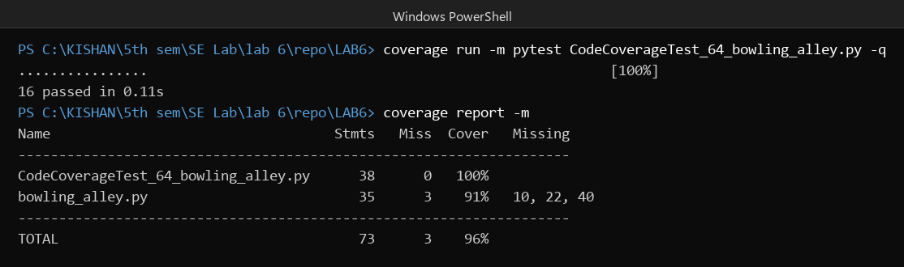
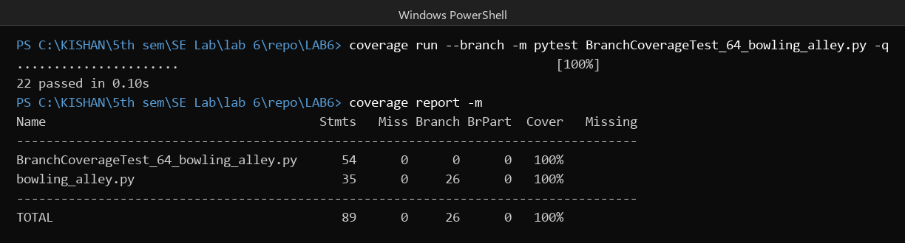
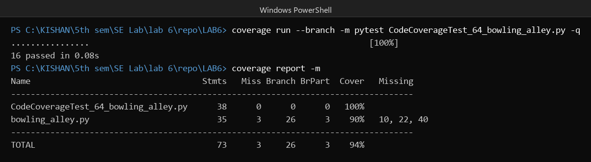

# Lab 6 Coverage Report, Bowling Alley

Name: KISHAN S
SRN: PES2UG23CS277
Slot: 64
Module under test: `bowling_alley.py`

## What the module does

`bowling_alley.py` has three functions. `lane_cost` prices a booking from the day type, number of games, players, shoe rentals and league membership. `frame_score` scores one bowling frame, so it handles strike, spare and open frame. `lane_assignment` picks a lane for the group and returns wait, bumper lane, two lanes or standard lane.

## How I ran it

```
coverage run -m pytest CodeCoverageTest_64_bowling_alley.py
coverage report -m

coverage run --branch -m pytest BranchCoverageTest_64_bowling_alley.py
coverage report -m
```

The `-m` flag in `coverage report` shows the missed lines. `--branch` makes coverage count each `if` as two paths, the true path and the false path. The module has 13 `if` statements, so there are 26 branch paths.

## Results

All numbers are for `bowling_alley.py` only, the test file is left out of the table.

| Run | Test file | Stmts | Miss | Branch | BrPart | Cover |
|---|---|---|---|---|---|---|
| Starter tests only | `test_bowling_alley.py` | 35 | 18 | 26 | 9 | 43% |
| Code coverage pass | `CodeCoverageTest_64_bowling_alley.py` | 35 | 3 | 26 | 3 | 91% |
| Branch coverage pass | `BranchCoverageTest_64_bowling_alley.py` | 35 | 0 | 26 | 0 | 100% |

## Code coverage pass



The first pass gives 91% line coverage. The report shows three missed lines:

- line 10, the `raise` for too many shoe rentals
- line 22, the `raise` for an invalid roll
- line 40, the `wait` answer when the group is bigger than 6 and only one lane is free

I did not write test cases for those three cases in the first file. The starter file alone was only 43%, so most of the work here was adding the normal price and scoring cases.

## Branch coverage pass



The second file has 22 tests and covers every line and every branch, so both numbers are 100% and `BrPart` is 0. The extra tests are the three cases above, plus the other two ways a roll can be invalid (`first_roll > 10` and a negative second roll), and a small group booking without the 100 per game surcharge.

## Line coverage compared to branch coverage

This is the part I understood after running both. The code coverage run gives 91% lines but only 23 of the 26 branches, which is 88%. Coverage.py reports 90% in the `Cover` column because that column mixes statements and branches in one number. The `Branch` and `BrPart` columns show the real story.



So the first file already had the `raise` line for an unknown day type covered, but that does not mean the `if` was tested both ways. A line gets counted when the execution touches it once. A branch only gets counted when both answers of the `if` are taken at least once. Three `if` statements in the module were only ever taken one way in the first pass, and they were lines 9, 21 and 39.

I did not test them by accident, I left them out. That is why the branch pass is a separate file and a separate commit.

## How to run the tests

```
cd LAB6
python -m pytest BranchCoverageTest_64_bowling_alley.py -v
coverage run --branch -m pytest BranchCoverageTest_64_bowling_alley.py
coverage report -m
```
